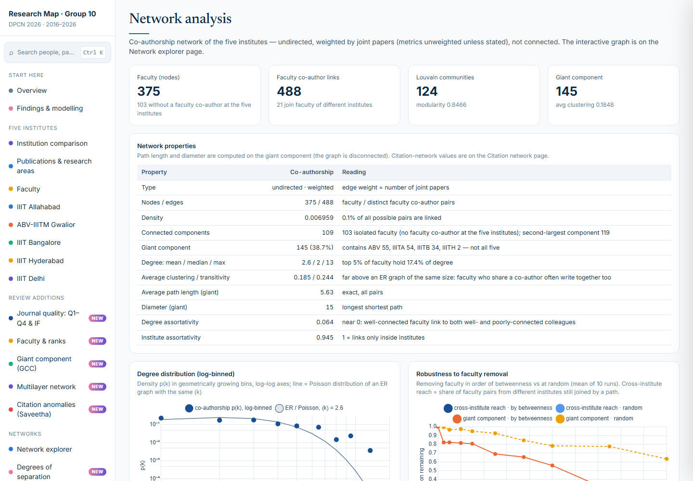

# Research networks of five IIITs (DPCN 2026 · Group 10)

Team **Titan Mandal** (Hrishikesh, Sarvesh, Shourya) · Instructor: Chittaranjan Hens

A network-science study of the research output of **IIIT Allahabad (IIITA)**,
**ABV-IIITM Gwalior (ABV)**, **IIIT Bangalore (IIITB)**, **IIIT Hyderabad (IIITH)**
and **IIIT Delhi (IIITD)**, 2016–2026, built from OpenAlex. It covers citation and
co-authorship networks, statistical baselines, an interactive dashboard and a
6-page report. IIITH and IIITD, the journal-quality split (Q1–Q4, impact factor),
faculty/student roles, the giant-component and multilayer analyses and the citation
anomaly check (Saveetha University) were added after the first review — see
[Review additions](#review-additions-november-2026).

* **Live dashboard: <https://heroic-gumdrop-32cb8b.netlify.app/>** (Netlify)
* **Report:** [10_IIIT.pdf](10_IIIT.pdf) (6 pages)
* **Decision log:** [DECISIONS.md](DECISIONS.md)

## Contents
[Overview](#project-overview) · [Key findings](#key-findings) · [Review additions](#review-additions-november-2026) ·
[Screenshots](#dashboard-screenshots) · [Dataset & privacy](#dataset-and-privacy) · [Methodology](#methodology) ·
[Network analysis](#network-analysis) · [Results](#results-and-interpretation) · [Architecture](#project-architecture) ·
[Setup](#installation-and-setup) · [Reproducibility](#reproducibility) · [Deployment](#deployment) ·
[Limitations](#limitations-and-future-work) · [Decision log](#decision-log)

## Project overview

**Research question.** How do the research networks of the five IIITs compare,
and how — and through whom — are the institutes connected to each other?

The course asks every group to map the output of Indian institutes of the same
cluster: publication statistics, a citation network, a co-authorship network and
their Indian connections. The five IIITs are similar institutes in different
cities, so they make a natural test case. Do institutes of the same type and
cluster form one research community, or separate ones? Who holds them together?

| Institution | OpenAlex | ROR | Papers 2016–2026 |
|---|---|---|---|
| IIIT Allahabad | `I26072440` | `03rgjt374` | 2,945 |
| ABV-IIITM Gwalior | `I9747756` | `008b3ap06` | 2,198 |
| IIIT Bangalore | `I181514455` | `05h9eqy10` | 1,436 |
| IIIT Hyderabad | `I64189192` | `05f11g639` | 4,512 |
| IIIT Delhi | `I119939252` | `03vfp4g33` | 3,819 |

14,762 unique journal and conference papers (148 are shared by two or more
institutes). 2026 is a partial year.

## Key findings

All values are computed by the pipeline. Evidence, interpretation and caveats for
each finding are on the dashboard's *Findings & modelling* page and in the report.

**How the institutes connect** (`part5b_network_structure.py`)
1. **Five institutional islands inside one connected component.** 646 of 22,867
   co-author links (2.8%) join two IIITs; a degree-preserving null model expects
   ≈17,160. 86% of the Louvain communities with ≥10 authors are ≥90% one
   institute, and institute assortativity is 0.962.
2. **Ties between IIITs follow people who moved.** 99 of the 137 papers linking two
   IIITs include an author whom OpenAlex places at both institutes. The strongest
   pairs are IIITH–IIITD (323 links, 79 joint papers) and IIITA–ABV (111).
3. **IIIT Bangalore is the most weakly attached.** Removing 23 authors cuts IIITB
   off from every other IIIT (IIITA and ABV 37, IIITH and IIITD 72).
4. **Connectivity depends on brokers.** Removing the 1% of authors with the highest
   betweenness cuts cross-institute reachability from 68% to 46% (2%: to 22%);
   random removal barely matters. Degree is heavy-tailed (max 231 vs ≈15 in an
   ER graph of the same size).
5. **Indirect ties through the same IITs.** 50 Indian institutions co-author with
   all five IIITs; IIT Kanpur, IIT Roorkee and IIT Kharagpur are the strongest
   common partners.
6. **Author disambiguation matters.** Merging authors because their names match
   creates false bridges; see [DECISIONS.md §2](DECISIONS.md#2-authors-with-identical-names).

**Output and impact** (`part5_insights.py`)
* Output grew 4.6–11.9% a year at all five institutes (log-linear fit, 2016–2025).
  The Q1 share of journal papers rose significantly at IIITA, ABV and IIITH (χ²,
  p < 0.001); IIITD started highest (65% → 69%).
* After normalising for year, field and paper type, mean citation impact is highest
  at IIITH (1.27) and IIITD (1.09) and lowest at conference-heavy IIITB (0.62).
* Citations are explained mostly by venue (Q1 +113%) and team size; international
  co-authorship adds +13% once these are held fixed (OLS, robust errors).
* 93% of citations between the five institutes' papers share an author
  (self-citation); 96% stay inside the citing institute, against 26% if targets
  are shuffled.

## Review additions (November 2026)

Built in `part5c_extensions.py` (+ `group10_roles.py`) and shown on five new
dashboard pages under *Review additions*.

| Request | What was done | Result |
|---|---|---|
| **Q1 / Q2 / Q3 / Q4 and IF >5, >10** | Journal papers split by Scimago quartile and by impact-factor band (≥10, 5–10, <5). IF = OpenAlex 2-year mean citedness of the journal (the JIF formula on open data). Per institute, per year and per faculty member. | Q1 share: IIITD 67%, IIITH 62%, IIITB 50%, IIITA 40%, ABV 39%. IF ≥10: IIITD 156 papers (9%), IIITH 126 (7%), ABV 74, IIITA 67, IIITB 32. Only 68% of Q1 papers are in IF ≥5 journals, so the two measures are not interchangeable. |
| **Faculty vs PhD students / students** | Names matched to the official faculty and student lists scraped from all five institute websites (`reference/faculty_rosters/`); conservative matching. Unlisted authors get a heuristic label. | 71–95 listed faculty found per institute (IIITA 71/76, ABV 74/80, IIITB 49/57, IIITH 95/108, IIITD 91/97). Students sit at one end of 76% of the links between institutes; listed faculty alone split into 245 components (largest 54%) — students are the glue between faculty groups. |
| **GCC** | Giant connected component: size, composition by institute and role, what lies outside it, year-by-year growth. | 7,794 of 9,451 authors (82.5%) and 96% of links; the next component has 21 authors. Share inside: IIITA 87%, IIITH 83%, IIITD 83%, ABV 78%, IIITB 75%. Grew from 21% of authors (2016) to 83%. |
| **Multilayer graph analysis** | Two-layer multiplex on the same authors (co-authorship, author-to-author citation): edge overlap vs a degree-preserving null, degree correlation, participation coefficient, mutually connected giant component; plus a 4-layer institute-level multiplex. | 37% of citation links join co-authors (52× random); layer degrees correlate (ρ = 0.50); 54% of authors are mutually connected in both layers. Between institutes the citation layer has 3,035 links among authors who never co-wrote vs 646 co-author links — the IIITs read each other far more than they collaborate. |
| **Saveetha University issue** | Citing institutions screened for citations out of proportion to collaboration and for papers dominated by one citer; three tests (size, who cites, topic) against the other top citers; sensitivity analysis. | Saveetha is #6 among Indian institutions citing the five IIITs (#1 for IIITA) with only 9 joint papers. But it writes 1.81% of all Indian papers and supplies 1.97% of the works citing us (1.09×, vs 1.74× for other large citers), and its citations do not come from the cited authors' co-author circle (18% vs 22%). Its prominence is explained by its size, not a citation circle aimed at the IIITs. Unusual: citing began only in 2022, fewer citing papers in the same field (57% vs 74%), and citing without collaborating. Removing its citations changes institute totals by ≤1.2%. |
| **IIIT Hyderabad and IIIT Delhi** | Added to every script, the dashboard (own pages and colours) and the report. | See the table above. |

## Dashboard screenshots

Screenshots of the implemented dashboard (`part4_dashboard.py`). Views that list
individual people are not included here.

| Overview | Network explorer |
|---|---|
|  |  |
| **Network analysis** | **Course connections** |
|  |  |


Dashboard pages: Overview · Findings & modelling (each finding labelled *Strong
evidence* or *Suggestive*) · Institution comparison · Publications & research areas
(research-profile radar, top venues, quartile mix by field, Lorenz curve, active
topics) · Faculty (all-institute table with role, Q1–Q4 and IF ≥5/≥10 columns, compare two faculty, papers-vs-citations) ·
one page per institute (faculty table, h-index, quartiles, top venues, departments,
most-cited papers) · Network explorer · **Degrees of separation** · **Network
growth** · Network analysis · Citation network · Indian connectivity · Course
connections · Data & methods (with a glossary of every term used). Behind *Show advanced
analysis*: Graph analytics (strongest pairs, recurring teams, local clustering, a
heuristic cross-institute "synergy" list) and Data audit & rigour (OpenAlex
completeness per institute, window vs career h-index).

The Overview follows the layout of a research-profile page suggested by the
instructor ([example](https://jfmendes-sciart.github.io/research.html)), with
every element drawn from our own data:
* a hero banner drawn from the real co-authorship network, with pulses along the
  links between institutes;
* a summary-of-statistics band with a **year selector** (From/To, period presets,
  click a lollipop, or a link such as `?years=2016-2019`) that recomputes papers,
  citations, h-index, Q1 share, active authors, co-author links and links between
  institutes for the chosen years, plus a citations-per-year lollipop chart (peak and
  partial year marked);
* research-interest chips per institute;
* a scrolling strip of the main partner institutions;
* a "selected publications" list of the 10 most-cited papers.

The Network explorer adds a top-N selector and summary counters.

Interactive features across the whole dashboard:
* **Search (Ctrl+K or `/`).** One search box for all 9,451 authors, all 14,762
  papers and every page, used with the keyboard.
* **Author profiles.** Clicking a name anywhere (any table, the explorer, search,
  the growth map) opens a side panel: papers, co-authors, betweenness rank,
  Louvain community, papers per year, co-authors at the five IIITs (those at
  another IIIT outlined), most-cited papers with DOI links and the OpenAlex
  profile. Profiles have shareable links (`#author=<OpenAlex ID>`), and every page
  has its own (`#explorer`, `#paths`, …).
* **Degrees of separation.** Pick two authors to see the shortest co-authorship
  chain between them in the full network (breadth-first search): where the chain
  crosses institutes, how many equally short chains exist, and how far every
  other author is from the first one. Buttons pick a random pair from two
  institutes or from one.
* **Network growth.** The full co-authorship network on one fixed layout, played
  year by year from 2016 to 2026 (authors appear with their first paper, links
  with the pair's first joint paper; links between institutes in pink). Counters
  and two charts follow the giant component and the links between institutes.
  The share of links that join two IIITs peaked in 2017 and has fallen since.

## Dataset and privacy

**What it is.** One row per (paper, assigned institute) for every journal or
conference paper 2016–2026 with an author affiliated to one of the five
institutes in [OpenAlex](https://openalex.org). The 14 columns required by the
course are present, plus analysis columns. Three network edge lists accompany it.
Quartiles come from Scimago SJR (year-matched) and conference ranks from ICORE2026
(`reference/`).

**Why it is not in this repository.** The dataset and its derived edge lists hold
author-level records. They are submitted privately to the instructor, so the
public repository contains only code, documentation, the report and aggregate
figures. These files are gitignored: `group10_data.csv`,
`citation_network.csv`, `authorship_network.csv`, `indian_connections.csv`,
`cache/`, `outputs/*.csv|json|md`, `dashboard.html`, `site/` and the scraped student
lists `reference/faculty_rosters/*_students.csv`. The faculty lists in
`reference/faculty_rosters/` are public directory information and are committed
with their source URLs. Impact factors come from OpenAlex source statistics
(`cache/sources.json.gz`).

> **Note.** These files were part of the initial commit (`4a161f4`), so they still
> exist in this repository's Git history. Purging them requires a history rewrite
> and force-push, which has not been done.

**Providing the data locally (authorised users).** Place the private `cache/`
folder in the project root, or regenerate it from OpenAlex (see
[Reproducibility](#reproducibility)).

## Methodology

* **Collection** (`part1_collect_data.py`): every OpenAlex work 2016–2026
  affiliated with the five institution IDs, plus Indian works that cite or are
  cited by them, fetched with batched filters. Requests are budget-aware and the
  caches make runs resumable.
* **Cleaning** (`group10_common.select_corpus`): journal and conference papers
  only. Preprints, book chapters, errata, editorials, datasets and retracted works
  are removed. Versions of one paper are merged by title + shared author, or by
  DOI, and citations are the maximum over versions.
* **Author validation** (`part1b_enrich_data.resolve_author_identities`): the
  OpenAlex author ID is the unit of identity. Records with the same name are
  merged only if they are at the same institute, never on the same paper, and
  share a co-author: 10,581 records → 9,451 authors; 1,779 same-name records are
  kept apart. External verification (ORCID, faculty pages) is **not** implemented;
  see DECISIONS.md.
* **Networks** (`part2_networks.py`):
  * *Citation:* node = paper, directed edge A → B if A references B (unweighted).
  * *Co-authorship:* node = author, undirected edge if two authors share a paper,
    weight = joint papers.
  * Edges to other Indian institutes go only into the CSV files, as the course
    requires.
* **Statistics and inference** (`part3`, `part5`): publication trends, quartiles,
  h-indices; log-linear growth; χ² test; normalised citation scores with bootstrap
  CIs; OLS with HC1 errors; homophily against 1,000 shuffled citation graphs.

## Network analysis

| | Co-authorship | Citation |
|---|---|---|
| Type | undirected, weighted | directed, unweighted |
| Nodes / edges | 9,451 / 22,867 | 14,762 / 16,788 |
| Connected? | no — 1,048 components, giant 82.5% | no — 6,811 weak components, largest 4,497 |
| Degree | mean 4.84, median 3, max 231 | in-degree mean 1.14, max 88 |
| Clustering | 0.639 (ER: 0.0005) | — |
| Path length / diameter (giant) | 6.06 / 18 (ER: 5.97)¹ | not meaningful (almost acyclic, fragmented) |
| Communities | Louvain Q = 0.909 (configuration-model null 0.431), stable over 10 seeds | — |

¹ With more than 6,000 authors, path lengths, the distance matrix and betweenness use a fixed (seeded) sample of
2,000 source authors; the diameter is the largest eccentricity found (a lower bound).

Implemented in `part5b_network_structure.py`:
* properties of both networks and of each institute's subgraph;
* a 3×3 mixing matrix compared with the configuration-model expectation d_A·d_B/2m;
* bridge authors and minimum node cuts between institutes;
* an all-pairs distance matrix;
* robustness under targeted vs random removal;
* ER G(n, m) baselines and a log-binned degree distribution;
* Louvain stability over 10 seeds;
* agreement between four centralities;
* a 3×3 citation matrix with and without self-citations;
* shared Indian partners;
* the identity-sensitivity analysis.

**Proposed, not run:** Leiden communities (Louvain is already stable) and link
prediction (too few inter-IIIT positives for a fair evaluation).

## Results and interpretation

The five IIITs are productive and growing. IIITH and IIITD lead on venue quality
(Q1 share, IF ≥10 papers) and normalised impact; IIITA and ABV are improving fastest
in Q1 share. Structurally, though, they are **separate research systems**:
* Collaboration and citation stay inside each institute.
* The ties that exist between IIITs come mostly from people who changed
  institutes; IIITH–IIITD (both strong CS institutes) and IIITA–ABV are the only
  substantial pairs.
* IIITB connects to the group only through a handful of individuals.
* Faculty groups are linked to each other mainly through students.
* The institutes read (cite) each other far more than they collaborate
  (multilayer analysis).

Each institute's largest partners include institutions in its own city, while
national IITs are what the five have in common. The network is robust to random
loss but fragile to the loss of a few dozen well-connected faculty. Saveetha
University's large citation volume is explained by its size; it does not change
any result materially.

Practical reading: direct IIIT–IIIT collaboration is rare and fragile. Joint
projects, co-supervised students and keeping in touch with people who move between
institutes are the levers that would connect them. Nothing here establishes causes;
see the limitations.

## Project architecture

```text
part1_collect_data.py        OpenAlex download → cache/ (private)
part1b_enrich_data.py        corpus rules, quartiles, author identity, faculty, Jaccard → group10_data.csv, outputs/
part2_networks.py            citation & co-authorship networks, citation flow, Indian connections
part3_statistics.py          descriptive charts + statistics summary
part5_insights.py            inferential tests, output/impact findings, report figures f1–f5
part5b_network_structure.py  structure & inter-institution analysis, structural findings, figures f6–f7
part5c_extensions.py         review additions: Q1–Q4 & IF bands, faculty vs students, GCC, multilayer, citation anomalies
group10_roles.py             name matching against the institute faculty / student lists
part4_dashboard.py           builds dashboard.html and site/index.html (D3 + Chart.js inlined)
part6_report.py              builds 10_IIIT.pdf (5 pages)
app.py                       Streamlit dashboard with filters (local use)
group10_common.py            configuration, OpenAlex client, classification rules
group10_analysis.py          shared loading and statistics (one source for every output)
reference/                   Scimago SJR 2016–2025, ICORE2026 ranks, institute faculty lists (public sources;
                             the scraped student lists are local only)
assets/                      D3 and Chart.js (inlined into the dashboard)
docs/                        course instructions, slides, README screenshots
netlify.toml                 static hosting config (publish = site/)
```

Data flow: `cache/` → `group10_data.csv` + network CSVs → `outputs/*.json` →
figures, `10_IIIT.pdf`, `site/index.html`. The report and both dashboards read the
same JSON files, so they cannot disagree.

## Installation and setup

Prerequisites: Python ≥ 3.10 (tested with 3.13). No Node.js is needed.

```bash
python -m venv .venv
.venv\Scripts\activate            # Windows  (macOS/Linux: source .venv/bin/activate)
pip install -r requirements.txt
```

Optional environment variables are listed in [.env.example](.env.example); none
are needed for an offline rebuild.

## Reproducibility

With the private `cache/` in place, every step runs offline (≈25 minutes for five institutes; `part5c_extensions.py` makes
≈25 extra OpenAlex requests the first time, for the Saveetha tests):

```bash
python part1b_enrich_data.py
python part2_networks.py
python part3_statistics.py
python part5_insights.py
python part5b_network_structure.py
python part5c_extensions.py
python part4_dashboard.py      # → dashboard.html and site/index.html
python part6_report.py         # → 10_IIIT.pdf
streamlit run app.py           # optional, local filtered dashboard
```

Without the cache, start with `python part1_collect_data.py`. It needs about 600
OpenAlex requests and resumes the next day if the free daily budget runs out.
OpenAlex is updated continuously, so a fresh download will differ slightly from
the numbers above.

## Deployment

**Live:** <https://heroic-gumdrop-32cb8b.netlify.app/>, hosted on Netlify and
deployed with Netlify Drop from a local build of `site/`. It was checked after
deployment: the served page matches the local build apart from a comment Netlify
adds, and every page renders without errors.

The dashboard is a static, self-contained HTML file. It needs no server, build
step or external requests, because D3 and Chart.js are inlined. `site/` is
gitignored because the page embeds author names and paper records, so it is
deployed from a local build rather than built from the repository.

**Netlify (recommended)**
1. Build: `python part4_dashboard.py` (creates `site/index.html`).
2. Either drag the `site/` folder onto <https://app.netlify.com/drop>, or use the CLI:
   ```bash
   npm install -g netlify-cli
   netlify login
   netlify deploy --dir=site --prod
   ```
3. To update the live site after re-running the pipeline, open the site in the
   Netlify UI → **Deploys** and drag the new `site/` folder onto it (or run
   `netlify deploy --dir=site --prod`). The URL stays the same.

The URL is the default of `DASHBOARD_LIVE_URL` in `group10_common.py`, which the
report uses. Set `DASHBOARD_URL` to override it if the site moves.

**Vercel alternative:** `npx vercel deploy site --prod`.

## Limitations and future work

* OpenAlex affiliation and reference coverage is incomplete, especially before
  2018. A missing affiliation removes an author or a link.
* Authors are not verified against ORCID. Faculty / student roles come from name
  matching against the *current* lists on the institute websites (retrieved
  2026-11-07): former faculty and graduated students are labelled by a heuristic,
  IIITA and ABV publish no student lists, IIITH lists students for only four
  research centres, and IIITD lists all PhD, M.Tech and B.Tech students. The
  conservative identity rule may still split some people (spelling variants), and an
  OpenAlex profile may combine two people.
* Impact factor is an open proxy (OpenAlex 2-year mean citedness, current value),
  not the Clarivate JIF, and is not year-matched.
* The Saveetha tests describe citation patterns; they cannot show intent. They cover
  Saveetha's citations *to the five IIITs*, not Saveetha's citations of its own
  faculty (the subject of the 2023 *Science* / Retraction Watch investigation).
* Each author is assigned one main institute. The networks are 2016–2026
  snapshots, and node cuts and robustness describe that snapshot only.
* "Core faculty" (still used in some charts) is a heuristic. Departments are
  often inferred from research fields. CORE ranks cover only listed venues.
* The analyses are associations and departures from null models, not causal
  effects.
* **Future work:**
  * ORCID verification of bridge authors, and archived (Wayback) faculty lists for
    former faculty;
  * a temporal analysis beyond the descriptive *Network growth* page (do
    inter-IIIT ties grow after moves?);
  * link prediction with a time-split evaluation once more inter-IIIT papers exist;
  * Leiden communities.

## Decision log

[DECISIONS.md](DECISIONS.md) records how authors were verified, how identical
names are handled, the full pipeline stage by stage, the key methodological
trade-offs, and what is public versus private. Read it before reusing the data or
extending the analysis.
