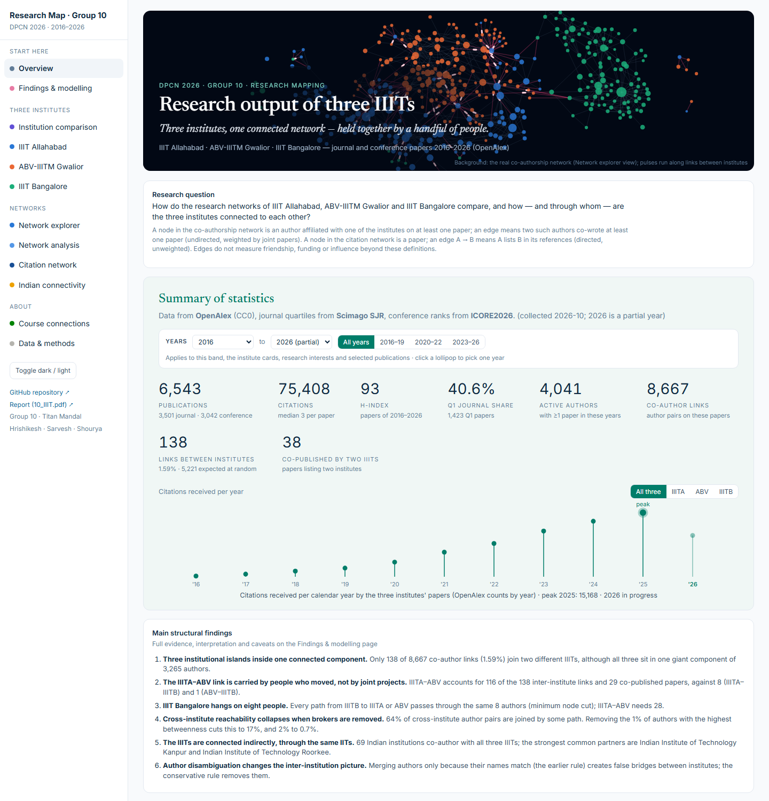
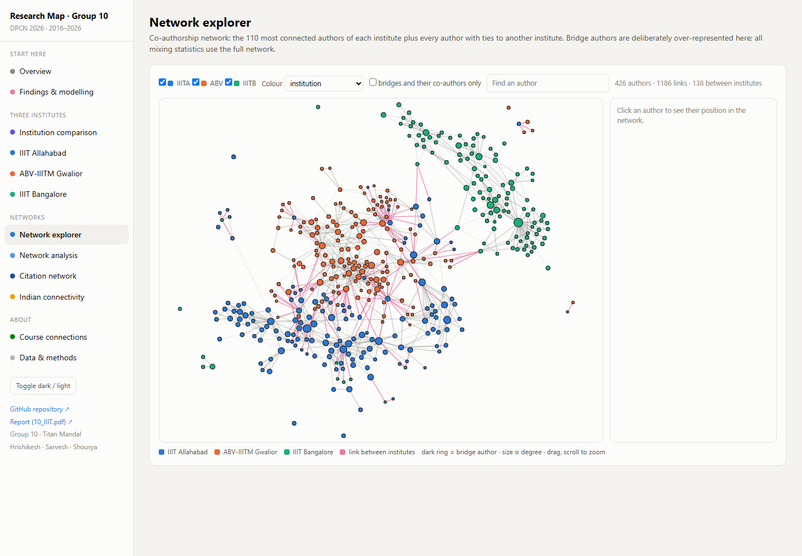
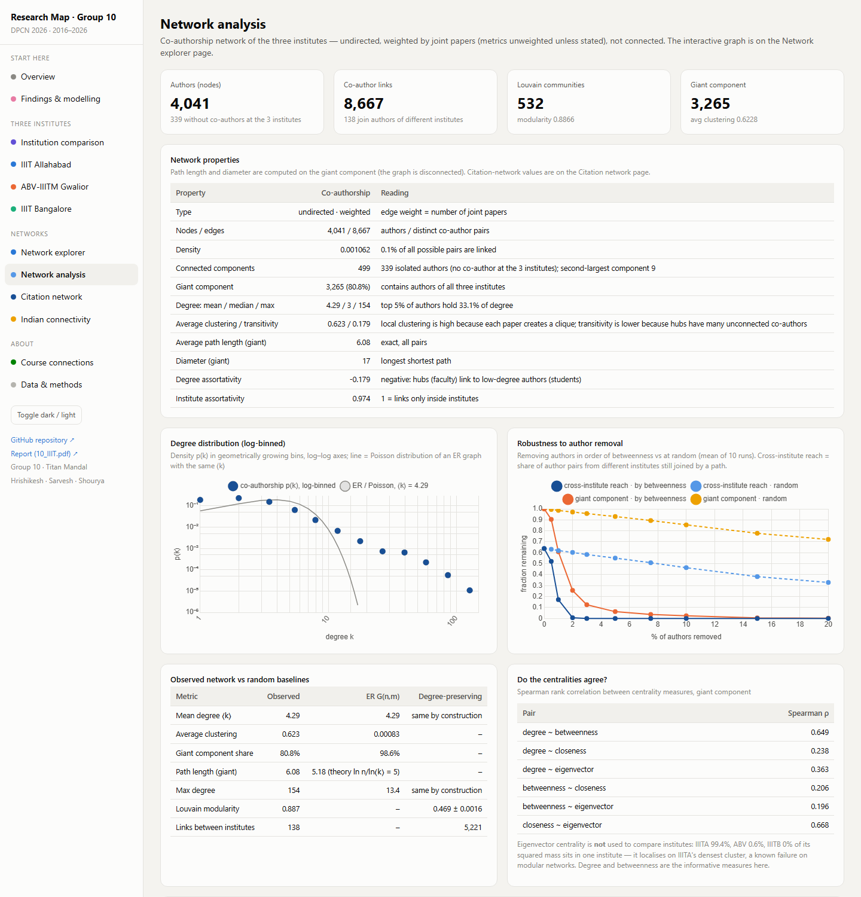
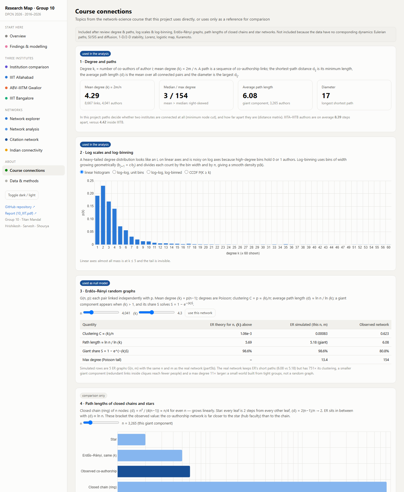
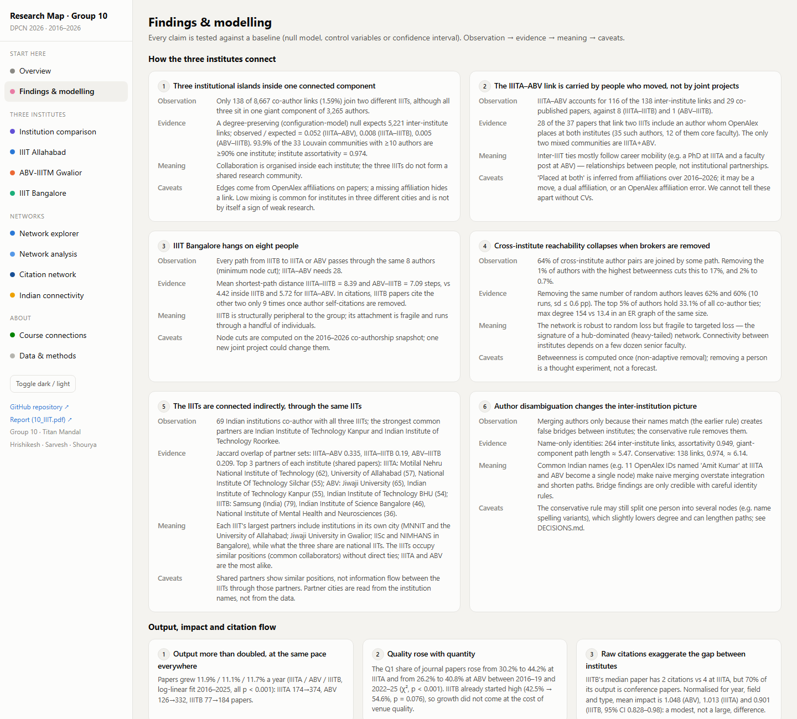

# Research networks of three IIITs (DPCN 2026 · Group 10)

Team **Titan Mandal** (Hrishikesh, Sarvesh, Shourya) · Instructor: Chittaranjan Hens

A network-science study of the research output of **IIIT Allahabad (IIITA)**,
**ABV-IIITM Gwalior (ABV)** and **IIIT Bangalore (IIITB)**, 2016–2026, built from
OpenAlex. It covers citation and co-authorship networks, statistical baselines,
an interactive dashboard, and a 5-page report.

* **Live dashboard: <https://sunny-buttercream-e0bf6c.netlify.app/>** (Netlify)
* **Report:** [10_IIIT.pdf](10_IIIT.pdf) (5 pages)
* **Decision log:** [DECISIONS.md](DECISIONS.md)

## Contents
[Overview](#project-overview) · [Key findings](#key-findings) · [Screenshots](#dashboard-screenshots) ·
[Dataset & privacy](#dataset-and-privacy) · [Methodology](#methodology) · [Network analysis](#network-analysis) ·
[Results](#results-and-interpretation) · [Architecture](#project-architecture) · [Setup](#installation-and-setup) ·
[Reproducibility](#reproducibility) · [Deployment](#deployment) · [Limitations](#limitations-and-future-work) ·
[Decision log](#decision-log)

## Project overview

**Research question.** How do the research networks of the three IIITs compare,
and how — and through whom — are the institutes connected to each other?

The course asks every group to map the output of 2–3 Indian institutes of the
same cluster: publication statistics, a citation network, a co-authorship network
and their Indian connections. The three IIITs are similar institutes in different
cities, so they make a natural test case. Do institutes of the same type and
cluster form one research community, or separate ones? Who holds them together?

| Institution | OpenAlex | ROR | Papers 2016–2026 |
|---|---|---|---|
| IIIT Allahabad | `I26072440` | `03rgjt374` | 2,946 |
| ABV-IIITM Gwalior | `I9747756` | `008b3ap06` | 2,198 |
| IIIT Bangalore | `I181514455` | `05h9eqy10` | 1,437 |

6,543 unique journal and conference papers (38 are shared by two institutes).
2026 is a partial year.

## Key findings

All values are computed by the pipeline. Evidence, interpretation and caveats for
each finding are on the dashboard's *Findings & modelling* page and in the report.

**How the institutes connect** (`part5b_network_structure.py`)
1. **Three institutional islands inside one connected component.** 138 of 8,667
   co-author links (1.6%) join two IIITs. A degree-preserving null model expects
   ≈5,221. 94% of the Louvain communities with ≥10 authors are ≥90% one institute,
   and institute assortativity is 0.974.
2. **The IIITA–ABV link comes from people who moved, not from joint projects.**
   IIITA–ABV holds 116 of the 138 links and 29 co-published papers, against 8
   (IIITA–IIITB) and 1 (ABV–IIITB). 28 of the 37 papers linking two IIITs include an
   author whom OpenAlex places at both institutes.
3. **IIIT Bangalore hangs on eight people.** All co-authorship paths from IIITB to
   the others pass through the same 8 authors (minimum node cut). IIITA–IIITB
   authors are on average 8.4 steps apart, versus 4.4 inside IIITB.
4. **Connectivity depends on brokers.** Removing the 1% of authors with the highest
   betweenness cuts cross-institute reachability from 64% to 17%. Removing the same
   number of random authors leaves 62%. The degree distribution is heavy-tailed
   (max 154 vs ≈13 in an ER graph of the same size).
5. **Indirect ties through the same IITs.** 69 Indian institutions co-author with
   all three IIITs; IIT Kanpur and IIT Roorkee are the strongest common partners.
   Partner-set Jaccard overlap is 0.19–0.34.
6. **Author disambiguation matters.** Merging authors because their names match
   (the earlier rule) almost doubled the inter-institute links (264 vs 138) and
   shortened paths. See [DECISIONS.md §2](DECISIONS.md#2-authors-with-identical-names).

**Output and impact** (`part5_insights.py`)
* Output grew ≈11–12% a year at all three institutes (log-linear fit, 2016–2025).
  The Q1 share of journal papers rose at IIITA and ABV (χ², p < 0.001).
* After normalising for year, field and paper type, mean citation impact is close
  across institutes (0.90–1.05). IIITB's low raw median reflects its
  conference-heavy output.
* Citations are explained by venue and team size, not by international
  co-authorship (OLS with robust errors).
* 94% of citations between the three institutes' papers share an author
  (self-citation). 97% stay inside the citing institute, against 40% if targets
  are shuffled.

## Dashboard screenshots

Screenshots of the implemented dashboard (`part4_dashboard.py`). Views that list
individual people are not included here.

| Overview | Network explorer |
|---|---|
|  |  |
| **Network analysis** | **Course connections** |
|  |  |



Dashboard pages: Overview · Findings & modelling · Institution comparison · one
page per institute (faculty table, h-index, quartiles, top venues, departments,
most-cited papers) · Network explorer · Network analysis · Citation network ·
Indian connectivity · Course connections · Data & methods.

The Overview follows the layout of a research-profile page suggested by the
instructor ([example](https://jfmendes-sciart.github.io/research.html)), with
every element drawn from our own data:
* a hero banner drawn from the real co-authorship network, with pulses along the
  links between institutes;
* a summary-of-statistics band with a **year selector** (From/To, period presets,
  click a lollipop, or a link such as `?years=2016-2019`) that recomputes papers,
  citations, h-index, Q1 share, active authors, co-author links and links between
  institutes for the chosen years, plus a citations-per-year lollipop chart (peak and
  partial year marked);
* research-interest chips per institute;
* a scrolling strip of the main partner institutions;
* a "selected publications" list of the 10 most-cited papers.

The Network explorer adds a top-N selector and summary counters.

## Dataset and privacy

**What it is.** One row per (paper, assigned institute) for every journal or
conference paper 2016–2026 with an author affiliated to one of the three
institutes in [OpenAlex](https://openalex.org). The 14 columns required by the
course are present, plus analysis columns. Three network edge lists accompany it.
Quartiles come from Scimago SJR (year-matched) and conference ranks from ICORE2026
(`reference/`).

**Why it is not in this repository.** The dataset and its derived edge lists hold
author-level records. They are submitted privately to the instructor, so the
public repository contains only code, documentation, the report and aggregate
figures. These files are gitignored: `group10_data.csv`,
`citation_network.csv`, `authorship_network.csv`, `indian_connections.csv`,
`cache/`, `outputs/*.csv|json|md`, `dashboard.html` and `site/`.

> **Note.** These files were part of the initial commit (`4a161f4`), so they still
> exist in this repository's Git history. Purging them requires a history rewrite
> and force-push, which has not been done.

**Providing the data locally (authorised users).** Place the private `cache/`
folder in the project root, or regenerate it from OpenAlex (see
[Reproducibility](#reproducibility)).

## Methodology

* **Collection** (`part1_collect_data.py`): every OpenAlex work 2016–2026
  affiliated with the three institution IDs, plus Indian works that cite or are
  cited by them, fetched with batched filters. Requests are budget-aware and the
  caches make runs resumable.
* **Cleaning** (`group10_common.select_corpus`): journal and conference papers
  only. Preprints, book chapters, errata, editorials, datasets and retracted works
  are removed. Versions of one paper are merged by title + shared author, or by
  DOI, and citations are the maximum over versions.
* **Author validation** (`part1b_enrich_data.resolve_author_identities`): the
  OpenAlex author ID is the unit of identity. Records with the same name are
  merged only if they are at the same institute, never on the same paper, and
  share a co-author: 4,643 records → 4,041 authors; 1,268 same-name records are
  kept apart. External verification (ORCID, faculty pages) is **not** implemented;
  see DECISIONS.md.
* **Networks** (`part2_networks.py`):
  * *Citation:* node = paper, directed edge A → B if A references B (unweighted).
  * *Co-authorship:* node = author, undirected edge if two authors share a paper,
    weight = joint papers.
  * Edges to other Indian institutes go only into the CSV files, as the course
    requires.
* **Statistics and inference** (`part3`, `part5`): publication trends, quartiles,
  h-indices; log-linear growth; χ² test; normalised citation scores with bootstrap
  CIs; OLS with HC1 errors; homophily against 1,000 shuffled citation graphs.

## Network analysis

| | Co-authorship | Citation |
|---|---|---|
| Type | undirected, weighted | directed, unweighted |
| Nodes / edges | 4,041 / 8,667 | 6,543 / 5,946 |
| Connected? | no — 499 components, giant 80.8% | no — 3,355 weak components, largest 837 |
| Degree | mean 4.29, median 3, max 154 | in-degree mean 0.91, max 25 |
| Clustering | 0.623 (ER: 0.0008) | — |
| Path length / diameter (giant) | 6.08 / 17 (ER: 5.18) | not meaningful (almost acyclic, fragmented) |
| Communities | Louvain Q = 0.887 (null 0.469 ± 0.002), stable over 10 seeds | — |

Implemented in `part5b_network_structure.py`:
* properties of both networks and of each institute's subgraph;
* a 3×3 mixing matrix compared with the configuration-model expectation d_A·d_B/2m;
* bridge authors and minimum node cuts between institutes;
* an all-pairs distance matrix;
* robustness under targeted vs random removal;
* ER G(n, m) baselines and a log-binned degree distribution;
* Louvain stability over 10 seeds;
* agreement between four centralities;
* a 3×3 citation matrix with and without self-citations;
* shared Indian partners;
* the identity-sensitivity analysis.

**Proposed, not run:** Leiden communities (Louvain is already stable) and link
prediction (too few inter-IIIT positives for a fair evaluation).

## Results and interpretation

The three IIITs are productive, growing and broadly comparable once field, year
and venue are accounted for. Structurally, though, they are **separate research
systems**:
* Collaboration and citation stay inside each institute.
* The ties that exist between IIITA and ABV come mostly from people who changed
  institutes.
* IIITB connects to the group only through a handful of individuals.

Each institute's largest partners include institutions in its own city, while the
national IITs are what the three have in common. The network is robust to random
loss but fragile to the loss of a few dozen well-connected faculty.

Practical reading: direct IIIT–IIIT collaboration is rare and fragile. Joint
projects, and keeping in touch with people who move between institutes, are the
levers that would connect the three. Nothing here establishes causes; see the
limitations.

## Project architecture

```text
part1_collect_data.py        OpenAlex download → cache/ (private)
part1b_enrich_data.py        corpus rules, quartiles, author identity, faculty, Jaccard → group10_data.csv, outputs/
part2_networks.py            citation & co-authorship networks, citation flow, Indian connections
part3_statistics.py          descriptive charts + statistics summary
part5_insights.py            inferential tests, output/impact findings, report figures f1–f5
part5b_network_structure.py  structure & inter-institution analysis, structural findings, figures f6–f7
part4_dashboard.py           builds dashboard.html and site/index.html (D3 + Chart.js inlined)
part6_report.py              builds 10_IIIT.pdf (5 pages)
app.py                       Streamlit dashboard with filters (local use)
group10_common.py            configuration, OpenAlex client, classification rules
group10_analysis.py          shared loading and statistics (one source for every output)
reference/                   Scimago SJR 2016–2025, ICORE2026 ranks (public sources)
assets/                      D3 and Chart.js (inlined into the dashboard)
docs/                        course instructions, slides, README screenshots
netlify.toml                 static hosting config (publish = site/)
```

Data flow: `cache/` → `group10_data.csv` + network CSVs → `outputs/*.json` →
figures, `10_IIIT.pdf`, `site/index.html`. The report and both dashboards read the
same JSON files, so they cannot disagree.

## Installation and setup

Prerequisites: Python ≥ 3.10 (tested with 3.13). No Node.js is needed.

```bash
python -m venv .venv
.venv\Scripts\activate            # Windows  (macOS/Linux: source .venv/bin/activate)
pip install -r requirements.txt
```

Optional environment variables are listed in [.env.example](.env.example); none
are needed for an offline rebuild.

## Reproducibility

With the private `cache/` in place, every step runs offline (≈10 minutes):

```bash
python part1b_enrich_data.py
python part2_networks.py
python part3_statistics.py
python part5_insights.py
python part5b_network_structure.py
python part4_dashboard.py      # → dashboard.html and site/index.html
python part6_report.py         # → 10_IIIT.pdf
streamlit run app.py           # optional, local filtered dashboard
```

Without the cache, start with `python part1_collect_data.py`. It needs about 600
OpenAlex requests and resumes the next day if the free daily budget runs out.
OpenAlex is updated continuously, so a fresh download will differ slightly from
the numbers above.

## Deployment

**Live:** <https://sunny-buttercream-e0bf6c.netlify.app/>, hosted on Netlify and
deployed with Netlify Drop from a local build of `site/`. It was checked after
deployment: the served page matches the local build apart from a comment Netlify
adds, and every page renders without errors.

The dashboard is a static, self-contained HTML file. It needs no server, build
step or external requests, because D3 and Chart.js are inlined. `site/` is
gitignored because the page embeds author names and paper records, so it is
deployed from a local build rather than built from the repository.

**Netlify (recommended)**
1. Build: `python part4_dashboard.py` (creates `site/index.html`).
2. Either drag the `site/` folder onto <https://app.netlify.com/drop>, or use the CLI:
   ```bash
   npm install -g netlify-cli
   netlify login
   netlify deploy --dir=site --prod
   ```
3. To update the live site after re-running the pipeline, open the site in the
   Netlify UI → **Deploys** and drag the new `site/` folder onto it (or run
   `netlify deploy --dir=site --prod`). The URL stays the same.

The URL is the default of `DASHBOARD_LIVE_URL` in `group10_common.py`, which the
report uses. Set `DASHBOARD_URL` to override it if the site moves.

**Vercel alternative:** `npx vercel deploy site --prod`.

## Limitations and future work

* OpenAlex affiliation and reference coverage is incomplete, especially before
  2018. A missing affiliation removes an author or a link.
* Authors are not verified against ORCID or faculty lists. The conservative
  identity rule may still split some people (spelling variants), and an OpenAlex
  profile may combine two people.
* Each author is assigned one main institute. The networks are 2016–2026
  snapshots, and node cuts and robustness describe that snapshot only.
* "Core faculty" is a heuristic. IIITB departments are mostly inferred from
  research fields. CORE ranks cover only listed venues.
* The analyses are associations and departures from null models, not causal
  effects.
* **Future work:**
  * ORCID / faculty-page verification of bridge authors;
  * a temporal analysis (do inter-IIIT ties grow after moves?);
  * link prediction with a time-split evaluation once more inter-IIIT papers exist;
  * Leiden communities.

## Decision log

[DECISIONS.md](DECISIONS.md) records how authors were verified, how identical
names are handled, the full pipeline stage by stage, the key methodological
trade-offs, and what is public versus private. Read it before reusing the data or
extending the analysis.
